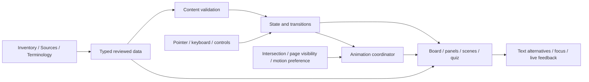

# Application architecture contract

Status: approved implementation contract. Acceptance status lives in TASKS; the legacy guide remains in index.html. See [decisions](DECISIONS.md) and [data contracts](DATA_MODEL.md).

## Static application organization

Use Next.js static export and React with strict TypeScript, Tailwind and bundled Geist. Keep the shell, SVG viewer, navigator, inspector, toolbar, scenes, assembly, signals, quiz and citations as separate modules. Zustand owns shared interaction state; immutable educational records live outside the store. Zod validates projections of canonical documents before rendering. High-frequency camera/pointer updates use refs rather than global React updates.

The production export runs over local HTTP without required internet resources or runtime content fetch. Contributor routes are generated at build time from an explicit document allowlist; render Markdown safely, translate internal documentation links and offer original-file downloads. Never expose arbitrary filesystem paths. Root index.html stays recoverable as the legacy file-URL guide. shadcn primitives and selective React Aria controls are restyled to DESIGN; each control has one accessibility implementation.

## Canonical owners and rendering

Inventory owns physical designators/values/positions. SOURCES owns bibliographic metadata; terminology owns definitions. REQUIREMENTS owns obligations; TASKS owns completion. Topic docs own explanations and evidence distinctions. The `components`, `zoomLevels`, `sources`, `quizQuestions`, `signalJourneys`, `terminology`, `materialEntries`, and `pinMappings` are projections conforming to DATA_MODEL. Repeated panels/cards/citations are generated from data rather than duplicated copy.

SVG board groups have stable unique DOM IDs, data-component-id/category, label, slot metadata, and appropriate keyboard behavior. Scene descriptions are HTML. Board coordinates derive from the CAD transform documented in [rendering](docs/engineering/rendering.md). Exact illustrations require specific evidence; otherwise use visible educational/conceptual labels.

## State and navigation

`mode`: explore/explode/assemble/zoom/signal/quiz. `selectedComponentId`: nullable ID. `detailDepth`: beginner/intermediate/deepDive. `zoom`: nodeId, branchId, history stack, originatingComponentId. `assembly`: selectedPartId, placed ID set, active pointer, drag origin. `signal`: journeyId, stepIndex, playing. `quiz`: questionIndex, answers keyed by question ID, submitted, score. `motion`: systemReduced, userPaused, documentVisible, visibleScenes. Search/filter, theme, responsive panels, camera focus/isolation/hidden IDs and exploded layout are also explicit. Session state needs no persistent storage.

Actions pass through explicit store transitions; render only affected regions. Examples: SELECT_COMPONENT, SET_MODE, ENTER_ZOOM, VISIT_NODE, ZOOM_BACK, PLACE_PART, RESET_ASSEMBLY, SIGNAL_STEP, ANSWER_QUIZ. Reject invalid IDs without corrupting state; show readable recovery. Switching mode releases pointer capture and stops mode-owned motion. Moving through zoom pushes actual history; Back restores component/panel and focus, not a guessed parent.

## Mode contracts

- Explore: assembled board, focused/hovered highlight, search/category filter, shared data-driven details.
- Explode: deterministic offsets and leader lines from assembly coordinates; reassemble restores view; reduced motion switches instantly.
- Assemble: semantic slot IDs and captured Pointer Events, correct-slot proximity snapping, wrong drop returns origin; keyboard/tap select-place uses the same action and correctness rule. Keep thresholds in screen pixels to preserve usability across view sizes.
- Zoom: graph neighbors, breadcrumbs, previous/next, source/scale labels, electrical explanation link, return origin.
- Signal: ordered causal steps with separate edge types (control/power/data/return/parallel); step/pause/restart and textual equivalent.
- Quiz: 12 reviewed questions, immediate explanation after submitting one answer, one score contribution per question, retry resets answers.

## Accessibility, citations, lifecycle

Desktop details are a labeled adjacent region; mobile details are a modal dialog/bottom sheet with focus containment, Escape/close, and restoration. Board list gives an equivalent entry point without navigating tiny SVG shapes. Native buttons/inputs expose controls. All canvas meaning appears in text; live regions announce outcomes, not frames.

Generate numbered source links from stable IDs in canonical order. References resolve to entries with title, organization, type, URL and caveats. Do not render unverified evidence as a working citation to an unrelated document.

One coordinator owns a single 3.5-second teaching-step interval; native SVG models update on input and run no particle loop. Short 240ms interface transitions settle automatically. The teaching interval starts only for an active visible scene with document visible, user not paused, and reduced motion disabled. IntersectionObserver and visibilitychange stop/restart it; cleanup cancels its timer/listeners/observer. Static meaning remains when motion is off. Camera dragging writes the SVG transform through a ref and commits on release. Assembly reads screen-space slot bounds only at drop; avoid layout work inside timed progression.

## Extension procedure

New component: verify and update inventory/topic evidence; add data record and physical/grouped references; add SVG group and semantic slot; link appropriate branch; validate references and keyboard/mobile selection. New zoom node: document its teaching goal/evidence/representation; add graph edges and renderer; verify previous/next/history and text alternative. Accepted changes require a decision entry and relevant task/requirements updates.
